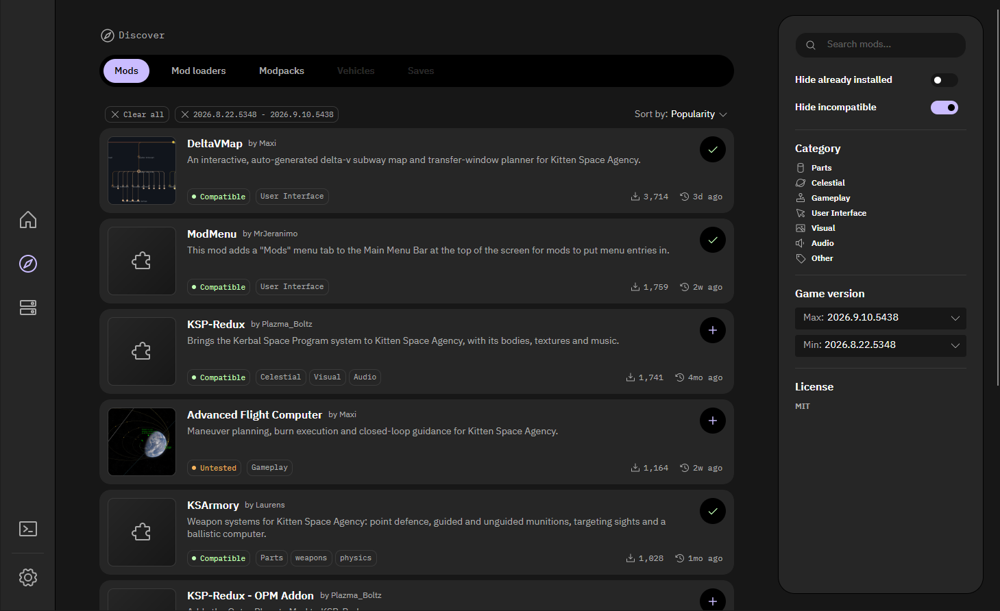

# Borea

[English](README.md) | 简体中文


[](https://hosted.weblate.org/engage/borea/)


Borea 是 Kitten Space Agency 的跨平台内容管理器。

它旨在管理模组、整合包、载具、游戏存档等内容。
目前已支持模组和整合包，载具和游戏存档支持将在后续加入。
Borea 从社区内容索引安装这些内容，将它们保存在各自独立的实例中，并使用你选择的实例启动游戏。
它支持 Windows、Linux 和 macOS，既提供桌面应用，也提供命令行工具。

Borea 是 [KSA Modding](https://github.com/KSAModding) 团队的社区项目。该团队同时维护 [KSA Modding Society Discord](https://discord.gg/nt4fK4QuTz)、[模组开发 Wiki](https://modding.kittenspaceagency.wiki/) 和 Borea 安装内容所用的[内容索引](https://github.com/KSAModding/content-index)。Discord 是 Kitten Space Agency 模组开发者交流的地方，这三项服务由同一批人维护。
Borea 并非由 RocketWerkz 制作，与 RocketWerkz 没有关联，也未获得其背书。
Kitten Space Agency 是 RocketWerkz 的游戏及商标。



## 获取帮助

- 问题与帮助：[KSA Modding Society Discord](https://discord.gg/nt4fK4QuTz)。
- 缺陷报告：[问题跟踪器](https://github.com/KSAModding/Borea/issues)。
- 参与贡献请参阅 [CONTRIBUTING.md](CONTRIBUTING.md)，报告安全问题请参阅 [SECURITY.md](SECURITY.md)。

## 功能

- 浏览[内容索引](https://github.com/KSAModding/content-index)，一键安装模组。Borea 会解析依赖、提供推荐内容，并在启动需要时安装模组加载器。
- 保留多个游戏实例，每个实例拥有各自的模组、存档和载具，并可在实例之间切换。游戏原有的用户配置目录保持不变。
- 在模组发布新版本时更新模组，并通过首页横幅或 `borea update-self` 更新 Borea 本身。
- 安装整合包，导出或导入模组列表，与他人分享一套配置。
- 通过模组加载器以正确的实例启动游戏；启动失败时查看原因、导致问题的模组，并可通过按钮将其禁用。
- 将手动安装的模组导入实例。
- 记录每个实例的游玩时长和上次游玩时间，在应用中查看游戏日志，并在任务页面查看 Borea 执行过的操作。
- 提供英语、德语和海盗口吻语言选项，以及深色和浅色主题。

Borea 获取的所有模组信息都来自内容索引，其规范由 [content-manager-design](https://github.com/KSAModding/content-manager-design) 中的 RFC 定义。
该索引包含两个仓库：[content-index](https://github.com/KSAModding/content-index) 保存模组作者编写的条目，[content-index-releases](https://github.com/KSAModding/content-index-releases) 保存为每次新发布生成的发布文件。
要将模组加入索引，只需向 content-index 提交一个包含单个 TOML 文件的拉取请求（PR）。
如果你的模组会读取 `Documents/My Games/Kitten Space Agency` 下的文件，请参阅[让你的模组在 Borea 实例中正常运行](docs/mod-authors.md)。

## 下载

每次发布都为每个平台提供两种压缩包。
应用压缩包包含一个程序 `borea`（Windows 上为 `borea.exe`）。
不带参数启动时，它会打开桌面应用。
每个用户只能运行一个应用实例，因此再次启动会将已打开的窗口置于前台。
带参数启动时，它会执行命令，例如 `borea --help`。
使用单个 `borea://` 链接启动时，例如 `borea://mod/<id>`，它会在应用中打开相应页面，应用也会为这些链接注册关联。
大多数用户应选择此压缩包。
CLI 压缩包仅包含命令行工具。
它的下载体积更小，适合脚本或没有桌面环境的计算机。

发布的构建包含 .NET 运行时，采用自包含部署，无需预先安装运行时。

每个压缩包还包含 `LICENSE` 和 `THIRD-PARTY-NOTICES.txt`，其中列出了随包提供的第三方软件的许可证。
应用压缩包解压后的文件夹名为 `Borea`（macOS 上为 `Borea.app`），CLI 压缩包则为 `Borea-Cli`。
请将该文件夹放在可长期保留的位置，例如 Windows 上的 `%LocalAppData%\Programs\Borea`、Linux 上的 `~/.local/share/Borea` 或 macOS 上的 `/Applications`，因为 Borea 会在其运行目录中更新自身。
如果 Mac 账户没有管理员权限，请改将 `Borea.app` 放在 `~/Applications` 中，否则 Borea 无法在 `/Applications` 中更新自身。

| 平台 | 应用与 CLI | 仅 CLI |
| --- | --- | --- |
| Windows | `Borea-<version>-win-x64.zip` | `Borea-Cli-<version>-win-x64.zip` |
| Linux | `Borea-<version>-linux-x64.tar.gz` | `Borea-Cli-<version>-linux-x64.tar.gz` |
| macOS，Apple 芯片 | `Borea-<version>-macos-arm64.tar.gz` | `Borea-Cli-<version>-macos-arm64.tar.gz` |

这些构建尚未进行代码签名，因此每次更新后，在 Windows 和 macOS 上首次启动时都需要额外操作。
有关发布构建方式、将对哪些内容签名，以及如何检查下载文件，请参阅[代码签名政策](https://ksamodding.github.io/Borea/code-signing.html)；相关工作在[问题 #678](https://github.com/KSAModding/Borea/issues/678) 中跟踪。

### Windows

1. 浏览器可能提示该文件不常被下载。请选择保留文件。
2. 解压前，右键单击 zip 文件，打开**属性（Properties）**，在**常规（General）**选项卡中勾选**解除锁定（Unblock）**，再单击**确定（OK）**。
3. 解压 zip 并启动 `borea.exe`。如需使用命令行，在任一种压缩包的解压目录中打开 PowerShell，运行 `.\borea.exe --help`。
4. 如果跳过第 2 步，Windows 会显示“Windows 已保护你的电脑（Windows protected your PC）”。原因是应用不常被下载且未签名。选择**更多信息（More info）**，再选择**仍要运行（Run anyway）**。
5. 如果 Windows 提示智能应用控制（Smart App Control）阻止了 Borea，则不会提供“仍要运行”选项。请返回第 2 步，解除 zip 文件的锁定，再重新解压到一个新文件夹。

每个新版本都会再次触发该提示。
Borea 不需要管理员权限。

在 Windows 11 24H2 及更新版本中，应用启动时不会打开控制台窗口。
在较早的 Windows 版本中，控制台窗口会短暂出现，并在应用启动后关闭。
如果双击 CLI 压缩包中的 `borea.exe`，它会提示你使用终端，并等待按下 Enter。

### Linux

解压应用压缩包并启动 `borea`，例如在解压目录中打开终端，运行 `./borea`。
首次启动后，Borea 会出现在桌面的应用菜单中，此后可从菜单直接启动，无需终端。
如需使用命令行，在任一种压缩包的解压目录中运行 `./borea --help`。
构建包含 .NET 运行时，但不包含运行时所依赖的系统库。
应用与 CLI 都需要 ICU 和 OpenSSL 库。
桌面应用还额外需要 X11、ICE、SM 和 fontconfig 库。
常见的桌面安装通常已经包含这些库。精简安装需要为桌面应用安装以下软件包：

- Debian 和 Ubuntu：`sudo apt install libx11-6 libice6 libsm6 libfontconfig1 libssl3`，以及对应发行版的 `libicu` 软件包，例如 `libicu76`。
- Fedora：`sudo dnf install libX11 libICE libSM fontconfig libicu openssl-libs`。

如果只使用 CLI，在 Debian 和 Ubuntu 上只需安装 `libssl3` 和 `libicu` 软件包；在 Fedora 上只需安装 `libicu openssl-libs`。

构建需要 glibc，因此不支持 Alpine 等基于 musl 的发行版。

### macOS

不支持 Intel 芯片的 Mac。

在 Finder 中双击应用压缩包进行解压，将 `Borea.app` 拖入**应用程序（Applications）**文件夹，再从该文件夹中打开。

由于构建未使用 Apple 开发者账户签名，macOS 可能阻止首次启动。
系统会提示 Apple 无法验证 Borea 是否包含恶意软件。
Borea 的完整源代码位于本仓库中，你可以自行检查。

1. 选择**完成（Done）**。不要选择**移到废纸篓（Move to Trash）**，因为这会删除 Borea。
2. 打开**系统设置（System Settings）**，进入**隐私与安全性（Privacy & Security）**，向下滚动至**安全性（Security）**。此处会列出 Borea，并提供**仍要打开（Open Anyway）**选项。
3. 使用密码或触控 ID（Touch ID）确认，然后再次打开 Borea，即可启动。

也可以在终端中移除下载标记，代替上述三步：`xattr -dr com.apple.quarantine /Applications/Borea.app`。
无论采用哪种方式，每个版本都需要操作一次。

命令行程序位于 `Borea.app/Contents/MacOS/borea`。
使用 `tar -xzf` 将 `Borea-Cli-` 压缩包解压到 `Borea-Cli` 后，其中的 `borea` 也需要相同的首次启动操作，或者运行 `xattr -dr com.apple.quarantine Borea-Cli`。

### 更新 Borea

点击首页横幅中的**立即更新（Update now）**，或运行 `borea update-self`，即可将所选更新通道中的最新版本安装到原目录，因此快捷方式仍然有效。
在 macOS 上，采用应用包形式之前的构建无法自行更新到应用包版本，需要手动下载一次应用压缩包，将 `Borea.app` 拖入 Applications，并删除旧的 `Borea` 文件夹。
如果 Borea 更新后无法启动，请将 `borea.exe.old`（Linux 上为 `borea.old`，macOS 上为 `Borea.app.old`）改回原名，以恢复此前的构建。

### 校验和与构建来源

每次发布中的 `SHA256SUMS.txt` 列出了所有压缩包和软件物料清单的校验和。

GitHub 还为每个已发布文件保存构建来源证明，将文件与生成它的工作流运行记录关联。

登录 `gh` 后，可按以下方式验证文件：

```sh
gh attestation verify <file> --repo KSAModding/Borea \
  --signer-workflow KSAModding/Borea/.github/workflows/release.yml
```

`Borea-<version>.cdx.json` 是应用压缩包的软件物料清单，采用 CycloneDX JSON 格式。
由于应用也包含命令行工具，此文件列出了应用和 CLI 的 NuGet 软件包。
`Borea-Cli-<version>.cdx.json` 是 CLI 压缩包的软件物料清单，仅列出 CLI 的软件包。
每份文件都包含各软件包的版本、许可证和哈希值。
每份清单的证明仅关联其所描述的压缩包，你可以使用以下命令验证它与某个压缩包的对应关系。
加上 `--format json` 后，输出中会包含经证明的清单。

```sh
gh attestation verify <archive> --repo KSAModding/Borea \
  --signer-workflow KSAModding/Borea/.github/workflows/release.yml \
  --predicate-type https://cyclonedx.org/bom
```

## 命令行

`borea` 可通过脚本执行 Borea 的操作。所有读取命令都支持 `--json`。
下表列出了设置和实例相关的命令。`borea --help` 会列出全部命令，包括 search、show、install、update、remove、launch、loader 和 pack。
命令成功完成时退出码为 0；操作失败时退出码为 1，原因输出到 stderr；命令行解析失败时退出码为 2。

| 命令 | 作用 |
| --- | --- |
| `borea settings show` | 输出游戏、模组加载器和内容库的位置、发布通道，以及共享模组存储是否启用。 |
| `borea settings set game <directory>` | 指定游戏安装目录。 |
| `borea settings set loader <loader-id> <directory>` | 指定已安装的模组加载器目录。 |
| `borea settings set channel <channel>` | 选择安装和更新时提供哪些发布状态的版本：`stable`（默认）、`testing` 或 `dev`。 |
| `borea settings set library <directory>` | 将实例和备份移至另一个文件夹，或使用该文件夹中已有的内容库。`--default` 会将它们移回默认位置。 |
| `borea update-self` | 用所选更新通道中的最新版本替换当前 Borea 构建。`--check` 只报告将安装哪个版本。 |
| `borea settings set shared-store <on\|off>` | 将每个模组发布版本只存储一份，并将各实例链接到它（`on`，默认）；或为每个实例单独保存副本（`off`）。 |
| `borea game version` | 输出已安装的构建版本，以及主服务器报告的当前公开构建版本。 |
| `borea game check` | 检查游戏安装是否符合 Borea 对其结构和状态的预期。不符合时以退出码 1 退出。 |
| `borea instance list` | 输出所有实例，并标记当前活动实例。 |
| `borea instance show <instance>` | 输出某个实例、其模组所需的加载器、启动参数、上次游玩时间和游玩时长。 |
| `borea instance create <name>` | 创建空实例。 |
| `borea instance duplicate <instance> [--name <name>]` | 创建具有相同模组、版本和启用标记的实例。 |
| `borea instance export <instance> [file]` | 将实例中的模组及其版本和启用标记写入模组列表。 |
| `borea instance import <file> [--name <name>]` | 从模组列表创建实例。 |
| `borea instance rename <instance> <new-name>` | 重命名实例。 |
| `borea instance arguments <instance>` | 输出每次启动该实例时传给模组加载器和游戏的启动参数。 |
| `borea instance set-arguments <instance> -- <arguments>` | 将 `--` 后的参数保存为该实例的启动参数，替换已保存的参数。 |
| `borea instance clear-arguments <instance>` | 移除实例的启动参数。 |
| `borea instance delete <instance>` | 删除实例、其文件夹，以及其存档和载具的备份。 |
| `borea instance activate <instance>` | 将实例设为活动实例。 |
| `borea instance deactivate` | 取消当前活动实例，使所有实例均处于非活动状态。 |
| `borea instance scan <instance>` | 输出并非由 Borea 安装的模组文件夹，以及已记录但文件夹已不存在的模组。 |
| `borea instance adopt <instance> <folder> --archive <path>` | 将非 Borea 安装的模组文件夹登记为内容索引中的某个发布版本，该版本的压缩包须与文件夹内容匹配。 |
| `borea instance take-ownership <instance> <mod-id> [--with-dependencies] [--without-dependencies]` | 将模组所登记的发布版本重新安装到其文件夹，使 Borea 接管文件并能够更新和移除它。该发布版本未包含的原有文件会丢失。如果实例缺少必需依赖，命令会停止，除非使用 `--with-dependencies` 先安装依赖，或使用 `--without-dependencies` 在缺少依赖的情况下继续。 |
| `borea instance import-profile <name> [--dry-run]` | 复制共享用户配置目录中的模组来创建实例，保留相同的加载顺序和启用状态。共享用户配置目录保持不变。 |
| `borea instance rename-save <instance> <save> <new-name>` | 重命名存档。Borea 会将名称写入存档的 `meta.toml`，并相应重命名其文件夹。游戏允许名称包含字母、数字、单个空格、`-` 和 `_`，最长 64 个字符。请先关闭游戏。 |
| `borea instance rename-vehicle <instance> <vehicle> <new-name>` | 以相同方式重命名已保存的载具。 |
| `borea instance backups <instance>` | 按从新到旧的顺序输出实例的存档和载具备份，以及各备份的创建时间、原因和大小。 |
| `borea instance restore-backup <instance> <backup> [--replace]` | 将备份恢复到原位置。`--replace` 会先将同名存档或载具移至备份中。请先关闭游戏。 |
| `borea instance delete-backup <instance> <backup>` | 永久删除备份。 |
| `borea enable <mod-id> [--instance <instance>]` | 让游戏加载某个模组。 |
| `borea disable <mod-id> [--instance <instance>]` | 阻止游戏加载某个模组。 |
| `borea pin <mod-id> [--instance <instance>]` | 将模组固定在当前版本。模组更新和整合包更新不会改变它；如果某个操作计划需要它的其他版本，该计划会停止。 |
| `borea unpin <mod-id> [--instance <instance>]` | 取消版本固定，允许更新再次改变该模组的版本。 |

## 仓库结构

| 路径 | 说明 |
| --- | --- |
| `src/Borea.Core` | 领域模型：模组、整合包、实例、操作规划，以及其他项目实现的接口。不执行 I/O。 |
| `src/Borea.Storage` | 磁盘相关内容：设置、实例、备份、TOML 和索引缓存。 |
| `src/Borea.Network` | 网络相关内容：内容索引、SpaceDock、下载和图片。 |
| `src/Borea.Composition` | 组合根：根据已保存的设置为应用和 CLI 统一构建所有服务，只构建一次。 |
| `src/Borea.App` | 使用 Avalonia 构建的桌面应用。 |
| `src/Borea.Cli` | 命令行工具 `borea`，是同一套服务的轻量封装。 |
| `tests` | 每个源代码项目各有一个对应的测试项目。 |

## 构建

Borea 面向 .NET 10。安装 SDK 后运行：

```sh
dotnet build
dotnet test
dotnet run --project src/Borea.App
```

## 参与贡献

请先阅读 [CONTRIBUTING.md](CONTRIBUTING.md)。缺陷报告请提交至问题跟踪器，较大的想法请在 [content-manager-design 讨论区](https://github.com/KSAModding/content-manager-design/discussions)提出。

Borea 的翻译工作在 [Hosted Weblate](https://hosted.weblate.org/engage/borea/) 上进行，可直接通过浏览器参与，无需使用 git 或 C#。[本地化指南](docs/localization.md)介绍了具体方法，也说明了如何改为在 GitHub 网站上修正文字或提议添加新语言。

## 致谢

- [MrJeranimo](https://github.com/MrJeranimo)：Borea 的创建者和维护者之一，负责架构与发展方向。
- [Maximilian-Nesslauer](https://github.com/Maximilian-Nesslauer)：内容索引及其 RFC，以及目前应用与 CLI 的大部分实现。
- [averageksp](https://github.com/averageksp)：应用功能、测试及内容索引条目。
- [PlazmaBoltz](https://github.com/PlazmaBoltz)：最初的界面与主题。
- [renancamm](https://github.com/renancamm)（beik）：应用界面的 UI/UX 工作及 Borea 图标。

也感谢所有报告缺陷、测试构建或将模组加入索引的人。

## 许可证

Borea 采用 [MIT 许可证](LICENSE)。
每次发布中的 `THIRD-PARTY-NOTICES.txt` 列出了随附软件的许可证。

Borea 标志不在 MIT 许可证的授权范围内。请参阅 [BRANDING.md](BRANDING.md)。
